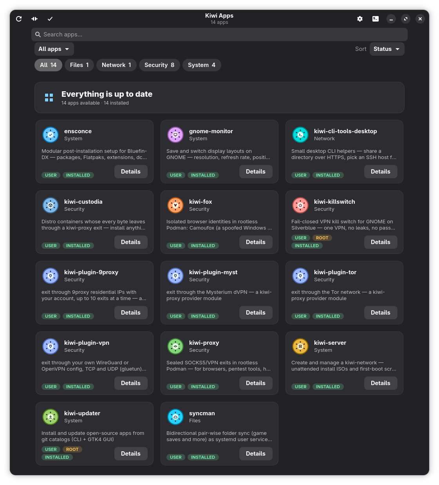
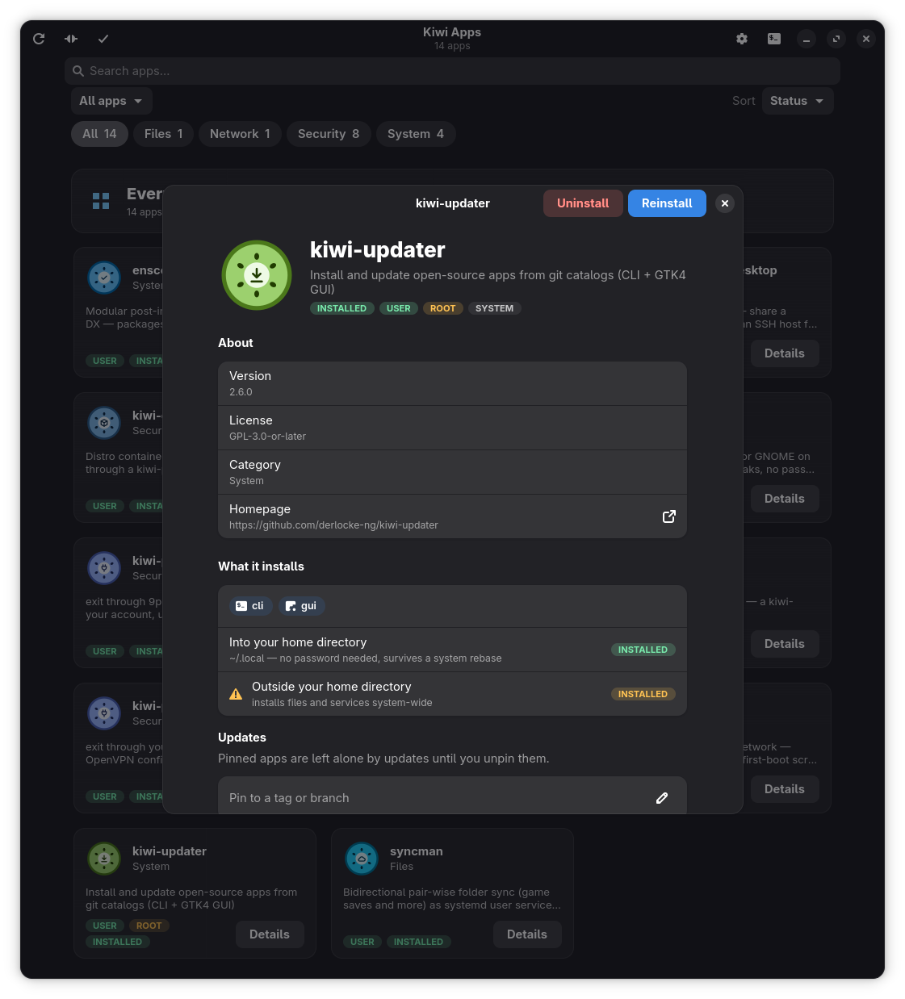
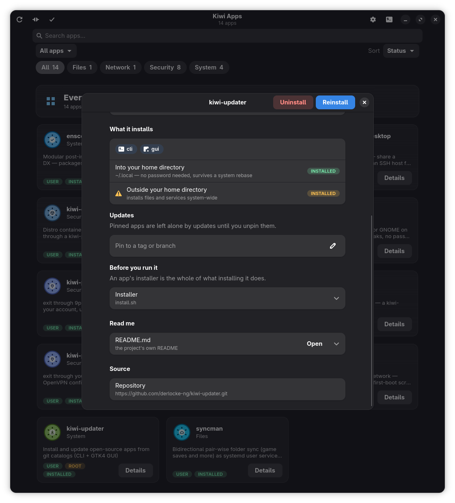
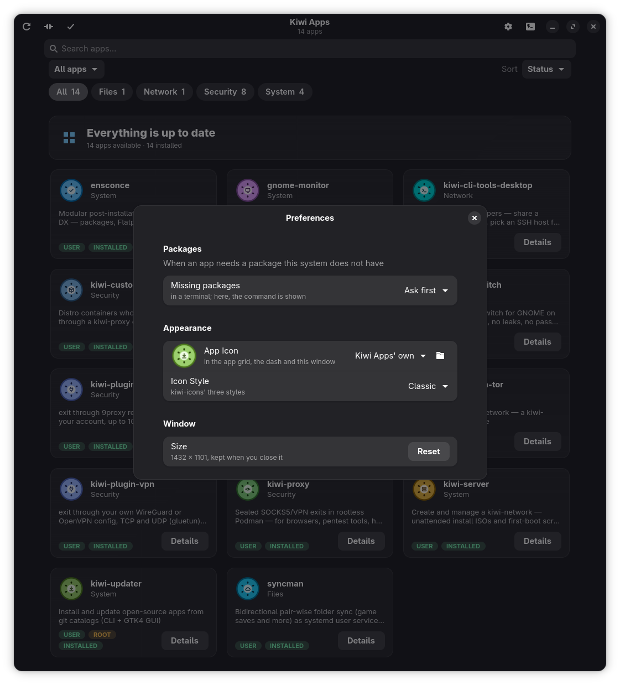
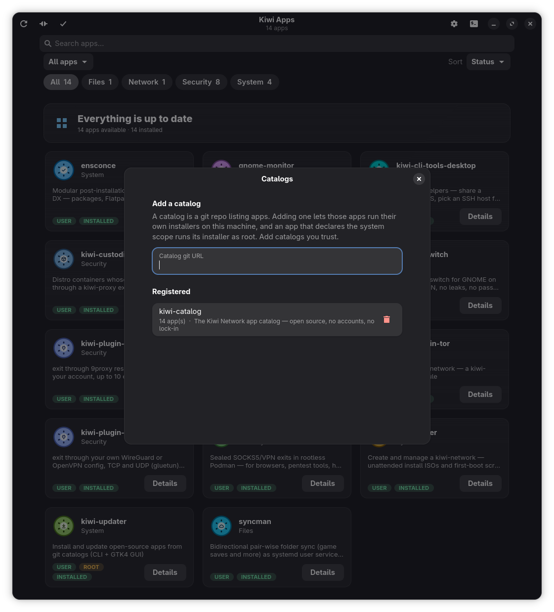

# Using nova

## Everyday commands

```bash
nova list                  # every app this machine knows about
nova list --check          # the same, and ask each app's repository for updates
nova search vpn            # find an app in every registered catalog
nova info <app>            # what it is, what it installs, whether it needs root
nova install <app>         # install an app (or several)
nova update                # update everything that has a new release
nova uninstall <app>       # remove an app; --purge also removes its settings
nova-gui                   # the desktop app, "Nova Apps"
```

`nova install` needs an app name, or `--all` to install every app of every
catalog. `nova update` without a name updates everything that is installed.

## Before you install or update

Installing an app runs that app's `install.sh`. These commands show what will
happen first:

```bash
nova info --installer <app>    # print the script an install would run
nova diff <app>                # what an update changes, including the script
nova install <app> --dry-run   # scope, source, version and script — and do nothing
```

To stay on a version until you decide otherwise:

```bash
nova pin <app> v1.2.0          # stay on v1.2.0
nova unpin <app>               # follow new releases again
```

## When something is wrong

```bash
nova doctor                    # missing tools, stale locks, version mismatch, bad list files, timers
nova version                   # this copy and the root-owned copy
```

`nova doctor` exits with a non-zero code when it finds something.

## All commands

| Command | What it does |
|---|---|
| `nova list [--check] [--no-sync]` | Every known app. `--check` also asks for updates; `--no-sync` stays offline. |
| `nova search <term>` | Search names, descriptions, components, categories, tags and URLs. |
| `nova info [--installer] <app>` | Details, dependencies, why it needs root; `--installer` prints the script. |
| `nova install <app>… \| --all` | Install. Also re-installs an installed app. |
| `nova update [<app>…]` | Update the named apps, or everything installed. |
| `nova uninstall <app>… [--purge]` | Remove; `--purge` also removes the app's settings and data. |
| `nova check` | Exit code `10` when updates are available, `0` when not. For scripts. |
| `nova diff <app>` | Commits, files and installer changes an update would bring. |
| `nova pin <app> <tag>` / `nova unpin <app>` | Stay on a version / follow releases again. |
| `nova add <git-url>` | Track one repository directly, without a catalog. |
| `nova add --system <https-url>` | Let root install and update this repository (asks for your password). |
| `nova catalog add <url>` / `list` / `remove <url>` | Manage catalogs. See [Catalogs](catalogs.md). |
| `nova sync` | Fetch catalogs and app details now. |
| `nova self-update` | Update nova itself (the background updates do this too). |
| `nova doctor` | Check the installation. |
| `nova trust --system <app>` | Forget the signing key root pinned for an app. See [Security](security.md). |
| `nova version` | Show the version of this copy and of the root-owned copy. |

Options can go anywhere on the line. `--` ends the options.

| Option | Effect |
|---|---|
| `--user`, `--system` | Only that part (scope) of an app. |
| `--cli-only`, `--gui` | Install without or with the app's desktop parts. nova remembers the choice for updates. |
| `--dry-run` | Say what would happen, change nothing. |
| `--force` | Run the installer even when nothing changed; uninstall even if the uninstaller fails. |
| `--purge` | With `uninstall`: also remove settings and data. |
| `--quiet`, `--notify` | Less output; a desktop notification after updates. |

## Scopes: the user part and the root part

Each app says in its manifest which parts it has:

- **user** — installed into `~/.local`, runs as you, never needs root;
- **system** — installed as root into `/usr/local`, `/etc` and `/var/lib`.

An app can have both. A catalog lists it once, and `nova list` shows one row.
An asterisk means part of it needs root:

```
NAME                 SCOPES       COMPONENTS             VERSION   STATUS
nova-killswitch      user+system* daemon cli gui gnome-… 0.2.3     installed
* needs root for part of the install
```

`nova info <app>` shows why an app needs root, before you are asked for a
password. What root may install, and when it asks, is described in
[Security](security.md).

## Nova Apps (the desktop app)

`nova-gui` shows the same apps as `nova list`. You can search, filter by
status and category, and open an app for its details: icon, screenshots,
README, dependencies, and the installer and update diff before they run. Pins
can be set there too. An installed app with a desktop window (`gui` in its
manifest's `COMPONENTS`) has an **Open** button there that starts it.







Clicks are queued: install several apps in a row and they run one after the
other, in as few password prompts as possible. The list first shows what is
installed, then fills in which apps have updates.

While an install, update or uninstall runs, a strip above nova's output shows
what is running and how many of its apps are done, next to a nova slice that
fills as they finish. The output below it is `nova`'s own, unchanged.

The gear button opens Preferences:

- **Updates**: "Check while open" — Nova Apps checks for updates by itself
  every minute, 5, 15 or 30 minutes, or every hour while its window is open,
  the same as pressing Refresh. It only shows what is new; you still press
  Update. The default is to check only when you press Refresh. A check never
  starts while an install or update is running.
- **Packages**: what nova does when an app needs a package this system does
  not have (the `auto-deps` setting, see [Settings](#settings)). Nova Apps
  has no terminal to ask in, so "Ask first" shows the install command in the
  output instead.
- **Appearance**: the app icon in the app grid, the dash and the window. Pick
  one of the nova-icons colourways and styles, or an icon of your own: put a
  PNG or SVG file in `~/.config/nova-updater/icons/` (the folder button opens
  it) and open Preferences again. Updates of nova keep your choice.
- **Window**: Nova Apps keeps its size when you close it; Reset goes back to
  the default size. "Show output while working" is on by default; switched
  off, a job shows only the strip with the nova, and nova's output opens by
  itself if the job fails. The output button in the header opens it at any
  time.

These choices are in `~/.config/nova-updater/gui.conf` and `window.json`.



The Catalogs button in the header adds and removes catalogs, like
`nova catalog add` and `remove` (see [Catalogs](catalogs.md)).



Nova Apps needs GTK 4 and libadwaita 1.5 or newer. It uses the `nova` command
for everything, so whatever it shows, `nova` can do from a terminal.

## Background updates

The install enables one user timer, `nova-updater.timer`. It runs
`nova update --all` 10 minutes after boot and then every 6 hours, as you.

- User parts are updated directly.
- Root parts — including nova's own root-owned copy — are updated through the
  passwordless helper, but only to releases signed by the key root pinned for
  that app. Anything else waits for your next `nova update` in a terminal,
  where you type your password.
- In manual mode, the timer leaves all root parts for your next
  `nova update`.

There is no root timer.

Check it with `systemctl --user status nova-updater.timer` or `nova doctor`.

## Settings

`nova config` shows and changes nova's settings. There is one so far:

| Setting | Default | Effect |
|---|---|---|
| `auto-deps` | `ask` | What nova does when an app needs a package that is not installed. `ask`: show the install command and ask. `yes`: install it without asking. `no`: only show the command. |

```bash
nova config                    # show the settings
nova config auto-deps yes      # install missing packages without asking
nova config --system auto-deps yes   # the same for root apps (asks for your password)
```

Your settings are in `~/.config/nova-updater/settings`, root's are in
`/etc/nova-updater/settings`. In Nova Apps, Preferences → Packages →
"Missing packages" changes your `auto-deps`.

Whatever the setting, nova never installs packages during a background
update. On read-only systems (Fedora Atomic with `rpm-ostree`, openSUSE Leap
Immutable with `transactional-update`) it always asks first, because the
packages are only there after a restart.

nova also reads these environment variables. Root ignores all of them except
`NOVA_UNATTENDED`.

| Variable | Default | Effect |
|---|---|---|
| `NOVA_LOCK_WAIT` | `20` | Seconds to wait when another nova is running (usually the timer). |
| `NOVA_NET_TIMEOUT` | `180` | Seconds before a network git call is given up. |
| `NOVA_FETCH_JOBS` | `4` | How many repositories are asked at the same time. |
| `NOVA_GUI` | detected | `0` or `1`: force installs without or with desktop parts. |
| `NOVA_UNATTENDED` | unset | `1`: never ask for a password (the timer sets this). |

## For scripts

- `nova check` exits `10` when updates are available.
- `nova list --porcelain` prints one tab-separated line per app. Fields are
  only ever added at the end, never moved:

  | # | Field | # | Field |
  |---|---|---|---|
  | 1 | name | 10 | tags |
  | 2 | scopes | 11 | clone directory |
  | 3 | components | 12 | why it needs root |
  | 4 | status | 13 | scopes it is installed in |
  | 5 | version | 14 | pinned ref |
  | 6 | repository URL | 15 | icon (manifest `ICON`) |
  | 7 | description | 16 | where the entry comes from |
  | 8 | release it would update to | 17 | root lists this source (`1`/`0`; empty for user-only apps) |
  | 9 | category | | |

  Status is one of `installed`, `update-available`, `partial`,
  `not-installed`, `unreachable`.
- `nova info --porcelain <app>` and `nova catalog list --porcelain` print
  `key=value` lines and tab-separated lines.
